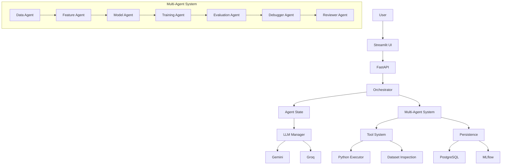
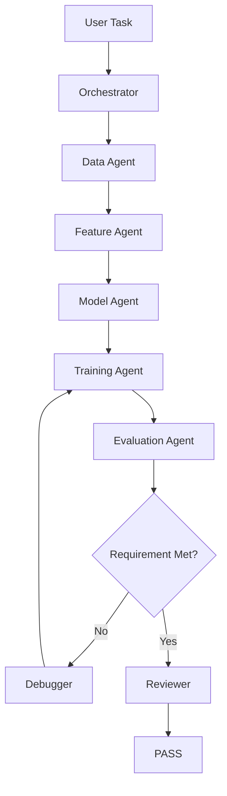

# MLForge

<div align="center">
  <p><strong>Multi-Agent Machine Learning Engineering Platform</strong></p>
  
  
  
</div>

---

MLForge is a multi-agent AI system that autonomously coordinates the machine learning workflow — from dataset analysis and feature engineering to model selection, training, evaluation, debugging, self-correction, and independent review. 

## Overview
Built to standardize and observe automated ML workflows, MLForge removes the black-box nature of AI-generated pipelines. By organizing strictly scoped AI agents around a central `AgentState`, the platform reliably crafts experiments without succumbing to token limits or hallucination drift.

## Features
- **🤖 Multi-Agent Engine**: Modular agents specialized in distinct ML tasks.
- **🎯 Intelligent Orchestration**: Dynamically plans and adjusts experiment routes.
- **🧠 Shared Agent State**: Predictable knowledge transfer replacing messy transcripts.
- **📊 Automated Dataset Analysis**: Profiles inputs and missing data autonomously.
- **🧬 Feature Engineering**: Handles imputation, encoding, and scaling pipelines.
- **🤖 Model Selection**: Proposes logical candidate models based on constraints.
- **🏋️ Automated Training**: Executes and tracks training runs securely.
- **📈 Evaluation**: Tests models against objective primary metrics (Accuracy, Recall, RMSE).
- **🔄 Self-Correction**: Automatically intervenes and rewrites code when loops fail.
- **👨‍⚖️ Independent Review**: Audits the pipeline for data leakage and overfitting.
- **🛡️ Reliability & Fallback**: Switches from Gemini to Groq instantly if providers fail.
- **📈 Observability**: Live UI tracing for full system transparency.
- **🧪 Automated Evaluation**: Built-in CLI framework for programmatic benchmarking.

## Architecture



## Agent Workflow



## Agents

| Agent | Responsibility |
|-------|----------------|
| Orchestrator | Plans and coordinates workflow |
| Data Agent | Profiles and analyzes datasets |
| Feature Agent | Determines preprocessing and feature engineering |
| Model Agent | Selects candidate ML models |
| Training Agent | Trains candidate models |
| Evaluation Agent | Evaluates models against requirements |
| Debugger | Diagnoses failures and recommends corrections |
| Reviewer | Independently reviews the final solution |

## Tool System
MLForge agents interact with the OS through strictly constrained tools.
- **Python Executor**: Executes generated scripts in a subprocess. Returns stdout/stderr.
- **Dataset Inspector**: Allows safe profiling of `.csv` and `.xlsx` limits.
- **File Reader**: Reads constraints and logs.

## Reliability
MLForge is designed for production stability. The internal `LLMManager` handles exponential backoff, rate limiting, and seamless failovers. 
Example Fallback Path: 
*Gemini → Failure → Retry → Failure → Groq → Continue*

## Observability
MLForge does not expose raw chain-of-thought to users. Instead, it exposes an **Agent Trace**, detailing events such as `workflow_id`, `agent_events`, `tool_events`, and `LLM_events`. This transparent logging ensures operators can debug the exact step a pipeline stalled on.

## Technology Stack

| Layer | Technology |
|-------|------------|
| Language | Python 3.10 |
| LLMs | Gemini + Groq (Llama 3) |
| Backend | FastAPI |
| Frontend | Streamlit |
| ML | Scikit-learn, Pandas |
| Database | PostgreSQL |
| Tracking | MLflow |
| Containers | Docker, Docker Compose |
| Testing | Pytest |

## Installation

**Prerequisites:** Python >= 3.9, Docker, API Keys.

1. **Clone the repository:**
   ```bash
   git clone https://github.com/yourusername/MLForge.git
   cd MLForge
   ```
2. **Setup virtual environment:**
   ```bash
   python -m venv .venv
   source .venv/bin/activate
   pip install -r requirements.txt
   ```
3. **Configure Environment:**
   Copy `.env.example` to `.env` and fill in your Gemini and Groq API keys.
4. **Start Infrastructure:**
   ```bash
   docker compose up -d postgres mlflow
   ```
5. **Run Services:**
   ```bash
   uvicorn api.main:app --reload
   streamlit run ui/app.py
   ```

## Quick Start
1. Clone the repository and configure `.env`.
2. Start the FastAPI and Streamlit services.
3. Open the UI (`localhost:8501`).
4. Upload `heart_disease_500.csv`.
5. Enter Objective: "Predict whether a patient has heart disease."
6. Select Target Column and set Metric to "Recall".
7. Click "Run MLForge".
8. Inspect the Agent Trace live as models train.
9. Review the final approved model!

## API
Check `localhost:8000/docs` for the interactive OpenAPI documentation covering Authentication, Workflow creation, Trace endpoints, and Evaluation.

## Testing
Run the evaluation test harness programmatically:
```bash
python -m evaluation.runner --mode mock
```
Run unit tests:
```bash
pytest tests/
```

## Performance & Limitations
See `docs/evaluation.md` for performance metrics.
**Limitations:**
- Model quality strictly depends on dataset quality.
- Fallback success depends on the API availability of secondary LLM providers.
- Training speed is dependent on underlying hardware capabilities.
- Currently specialized for Tabular machine learning workloads.

## Future Improvements
- Kubernetes deployment templates.
- Additional Computer Vision and NLP agent pipelines.
- Distributed training workers.

## License
License decision required.
