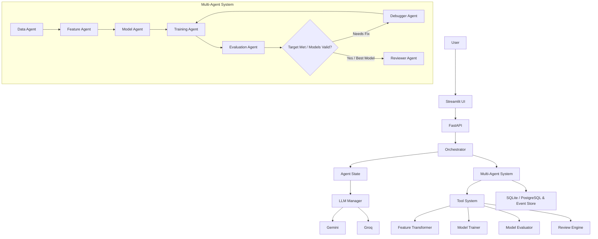

# MLForge

<div align="center">
  <p><strong>Multi-Agent Machine Learning Engineering Platform</strong></p>
  
  
  
</div>

---

MLForge is a multi-agent AI system that autonomously coordinates the machine learning workflow — from dataset analysis and feature engineering to model selection, training, evaluation, debugging, self-correction, and independent review. 

## Overview
Built to standardize and observe automated ML workflows, MLForge removes the black-box nature of AI-generated pipelines. By organizing strictly scoped AI agents around a central `AgentState`, the platform reliably crafts experiments without succumbing to token limits or hallucination drift.

## Features
- **🤖 Multi-Agent Engine**: Modular agents specialized in distinct ML tasks (Data, Feature Engineering, Modeling, Training, Evaluation, Debugger, Reviewer).
- **🎯 Intelligent Orchestration**: Dynamically plans, executes, and self-corrects experiment routes.
- **🧠 Shared Agent State**: Centralized state management ensuring clean context propagation without hallucination drift.
- **📊 Automated Dataset Analysis**: Profiles inputs, dirty records, missing values, and column anomalies autonomously.
- **🧬 Feature Engineering**: Handles dirty unit strings (e.g. `149 mmHg` $\rightarrow$ `149.0`), outlier label filtering, one-hot cardinality caps, scaling, and imputation.
- **🤖 Model Selection & Training**: Proposes and trains candidate algorithms (RandomForest, GradientBoosting, XGBoost, LightGBM, LogisticRegression).
- **📈 Evaluation & Target Thresholds**: Evaluates models against user-specified primary metrics and customizable target thresholds.
- **🔄 Automated Self-Correction**: Automatically intervenes, diagnoses training failures, and retries with tuned hyperparameters and preprocessed data.
- **👨‍⚖️ Independent Review**: Audits the pipeline against data leakage, metric anomalies, and overfitting before deployment approval.
- **🛡️ Provider Fallbacks & Reliability**: Transparent multi-provider fallback (Gemini $\leftrightarrow$ Groq) with exponential backoff.
- **📡 Real-Time Observability**: Live UI tracing stream capturing LLM calls, token usage, tool executions, and step-level statuses.
- **🧪 Built-in Evaluation Dashboard**: Interactive benchmark interface and CLI harness to validate workflows and agent robustness.

## Architecture



## Agents

| Agent | Responsibility |
|-------|----------------|
| **Orchestrator** | Plans and coordinates workflow execution and self-correction cycles |
| **Data Agent** | Profiles, analyzes schemas, and flags dirty or anomalous data |
| **Feature Agent** | Plans preprocessing, encoding, scaling, unit-cleaning, and transformations |
| **Model Agent** | Selects candidate ML models suited for the task type |
| **Training Agent** | Trains baseline and candidate models using preprocessed splits |
| **Evaluation Agent** | Evaluates models on test data against chosen metrics and thresholds |
| **Debugger** | Diagnoses training/validation failures and plans corrective actions |
| **Reviewer** | Independently reviews the best model, feature importances, and validation metrics |

## Observability & Live Tracing
MLForge provides full transparency into multi-agent operations without exposing raw, cluttered chain-of-thought:
- **Agent Events**: Step transitions, planning decisions, and review verdicts.
- **LLM Traces**: Real-time provider selection (Gemini/Groq), prompt tokens, completion tokens, latency, and fallback attempts.
- **Tool Traces**: Live execution status of dataset readers, feature transformers, training modules, and evaluation tools.

## Technology Stack

| Layer | Technology |
|-------|------------|
| Language | Python 3.10+ |
| LLMs | Google Gemini + Groq (Llama 3 / Mixtral) |
| Backend | FastAPI, SQLAlchemy, SQLite / PostgreSQL |
| Frontend | Streamlit, Pandas |
| ML & Data | Scikit-learn, XGBoost, LightGBM, NumPy |
| Testing | Pytest, Built-in Evaluation Suite |

## Installation & Setup

### Prerequisites
- Python 3.10+
- Gemini API Key and/or Groq API Key

### 1. Clone the repository
```bash
git clone https://github.com/Devadn11206/MULTI_AI_AGENTS.git
cd MULTI_AI_AGENTS
```

### 2. Set up virtual environment
```bash
python -m venv .venv
# Windows:
.venv\Scripts\activate
# Linux/macOS:
source .venv/bin/activate

pip install -r requirements.txt
```

### 3. Configure Environment Variables
Create a `.env` file in the project root:
```env
GEMINI_API_KEY=your_gemini_api_key_here
GROQ_API_KEY=your_groq_api_key_here
DATABASE_URL=sqlite:///./mlforge.db
SECRET_KEY=mlforge_secret_key_change_in_production
```

### 4. Run the Platform
In your first terminal (FastAPI backend):
```powershell
$env:PYTHONPATH="."
uvicorn api.main:app --port 8000 --reload
```

In your second terminal (Streamlit UI):
```powershell
$env:PYTHONPATH="."
streamlit run ui/app.py --server.port 8501
```

Open your browser to:
- **Studio UI**: `http://localhost:8501`
- **Interactive API Docs**: `http://127.0.0.1:8000/docs`

## Evaluation & Benchmarking
Run the automated evaluation suite via CLI:
```bash
python -m evaluation.runner --mode mock
# Or for live agent benchmark:
python -m evaluation.runner --mode live
```
Or navigate to the **Evaluation** mode in the Streamlit web interface to inspect evaluation history and run benchmarks directly.

## License
MIT License
